# CMSC 128 — My Tasks (Lab 1: CRUD · Lab 2: Accounts · Lab 3: Multi-user access control)

A multi-user to-do list app. People create an account, sign in, stay signed in,
manage their profile, and recover a forgotten password by email (Lab 2). Each
signed-in user gets their **own** task list (create, read, update, delete, undo,
filter, sort; Lab 1), plus shared lists with the people they choose (Lab 3).
Nobody can see or change another user's tasks.

**Author:** JP Salomeo
**Stack:** Flutter (Dart) + Firebase Authentication + Cloud Firestore — "FlutterFire"
**Branches:** `act3-ubac` (Lab 3, this one) · `act2-accounts` (Lab 2) · `main` (Lab 1).

---

## Lab 3: each user sees only their own tasks

Lab 3 merges the Lab 1 task list and the Lab 2 accounts into one app with
**user-based access control (UBAC)**:

- Every task belongs to one account, through an `ownerId` field holding that
  account's UID.
- Signing in lands straight on **your own** task list.
- Firestore's security rules check ownership on Google's servers for every read,
  create, update, and delete. Hiding things in the app is not what protects them.
- **Collaborative lists:** you can create shared lists, add other users by email,
  and see every list you've been added to, but never lists you weren't added to.

### How Lab 1 and Lab 2 were merged

| Step | Command | Result |
|---|---|---|
| 1 | `git switch -c act3-ubac` (from `act2-accounts`) | New branch for Lab 3 |
| 2 | `git merge main` | **"Already up to date."** No conflicts |

Why there were no conflicts: Lab 2 was built on top of Lab 1. The
`act2-accounts` branch started from `main`, so it already contained every Lab 1
commit, and merging `main` had nothing new to bring in. The real integration was
code, not a merge:

- **Tasks gained an owner.** `ownerId` is stamped on create, and the personal
  query filters on it.
- **Sign-in lands on the task list.** It used to land on the profile.
- **The rules changed** from "any signed-in user" to "the owner only", plus
  membership rules for shared lists.
- **New code:** a user directory and the shared lists (models, services, a
  drawer, a members screen).
- **Old data:** the 11 existing tasks, created before owners existed, were
  assigned to the main demo account with a one-off admin update made through the
  Firebase CLI's login (not part of the app).

### Schema

Accounts and their password hashes stay in **Firebase Authentication**. Everything
else is in **Cloud Firestore**, linked by the account's UID:

```
Firebase Authentication              Cloud Firestore
account: uid, email,        uid      users/{uid}          email, displayName
         password hash  ──────────▶  emails/{email}       uid            (lookup)
                                     tasks/{taskId}       title, dueDate, priority,
                                                          tag, isDone, ownerId ─▶ uid
                                     lists/{listId}       name, ownerId ─▶ uid,
                                                          memberIds[] ─▶ uid
                                       └─ tasks/{taskId}  task fields, ownerId ─▶ uid
```

| Collection | One document per | Purpose |
|---|---|---|
| `users/{uid}` | account | Public profile, so shared lists can show members' names. Readable one at a time by ID; **never listable**. Written only by its own account. |
| `emails/{email}` | account | Lookup from an exact email to a UID, for adding members. Readable one exact email at a time; **never listable**. |
| `tasks/{taskId}` | personal task | `ownerId` works like a foreign key to the account. |
| `lists/{listId}` | shared list | `ownerId` is the creator; `memberIds` is the membership list (the owner included). |
| `lists/{listId}/tasks/{taskId}` | task in a shared list | `ownerId` records which member created it. |

The schema stays normalized: tasks store only the owner's UID, never their name
or email. `users` and `emails` exist because the app can't look up *other*
accounts in Firebase Authentication. They hold no passwords.

### Where ownership is checked

The app filters every query by the signed-in user, and the rules refuse anything
that doesn't belong to them. Firestore checks a query against the rules *before*
running it, and refuses it if it **could** return someone else's document. This is
known as "rules are not filters". So the app can't just ask for "all tasks"; it
has to ask for "tasks where `ownerId` is me".

| Operation | App code | Firestore request | Rule (`firestore.rules`) |
|---|---|---|---|
| See my tasks | `TaskService.personal(...).watchTasks()` | `tasks` where `ownerId == uid` | read only if `resource.data.ownerId == request.auth.uid` |
| Add a task | `addTask` | `tasks.add({..., ownerId: uid})` | create only if `request.resource.data.ownerId == request.auth.uid` |
| Edit or tick | `updateTask`, `setDone` | `tasks/{id}.update(...)` | owner only, and `ownerId` can't change |
| Delete | `deleteTask` | `tasks/{id}.delete()` | owner only |
| **Open someone else's task by ID (IDOR)** | none | `tasks/{theirId}.get()` | **refused**: `PERMISSION_DENIED`, the 403-style failure the brief asks for |
| See my shared lists | `ListService.watchMyLists` | `lists` where `memberIds` contains `uid` | read only if `request.auth.uid in resource.data.memberIds` |
| Create a shared list | `createList` | `lists.add({ownerId: uid, memberIds: [uid]})` | in your own name, with yourself as a member |
| Add or remove a member | `addMember`, `removeMember` | `lists/{id}.update(memberIds ...)` | owner only; the owner stays a member; `ownerId` can't change |
| Delete a shared list | `deleteList` | one batch deletes its tasks, then the list | owner only |
| Tasks in a shared list | `TaskService.sharedList(...)` | `lists/{id}/tasks/...` | members only, checked with `get()` on the parent list on every request |
| Add a member by email | `UserService.findUidByEmail` | `emails/{email}.get()` | signed-in users can read one exact email; listing is refused |

### Proving it: automated rule tests

`rules-tests/ubac.test.js` runs **49 tests** against Firebase's local Firestore
emulator, never the real database. Each test plays one user (alice, bob, or
carol) and makes one request that must either succeed or be refused. They
include:

- reading, updating, or deleting another user's task by its ID (IDOR);
- creating a task in someone else's name;
- changing a task's owner;
- reading a list or its tasks without being a member;
- adding members when you're not the owner;
- listing every user's email.

Requirements: Java 21+ and Node.js.

```bash
npm --prefix rules-tests install
```

```bash
firebase emulators:exec --only firestore --project demo-my-tasks "npm --prefix rules-tests test"
```

Expected result: `tests 49 · pass 49 · fail 0`. The same tests, run against the
Lab 2 rules, fail 22 times, including all three IDOR cases.

### Demo accounts

Two accounts, both registered through the Lab 2 sign-up page:

- **Account A** owns the original tasks, and a shared list that includes B.
- **Account B** has its own tasks, and its own shared list that A is *not* in.

Sign in as A, then as B, and each sees only their own tasks and the shared lists
they belong to.

### Known limits

- **Adding a member by email reveals whether that exact email has an account.**
  Only signed-in users can do this, one exact address at a time. It's a
  deliberate trade-off against Lab 2's email-enumeration protection.
- **Firestore's offline copy on the device can still hold the previous user's
  tasks after logout.** They are never *shown*, because every query filters by
  owner, but they aren't erased either.
- **Members of a shared list can edit or delete any task in it.** That is what
  "collaborative" means here.
- **There's no "leave list" button for members;** the owner removes them.

---

## Tech stack, and why

| Layer | Choice | Why |
|---|---|---|
| Frontend | **Flutter 3.47** (Dart 3.13), Android | One codebase; the declarative widget model redraws from live streams (tasks, and now the signed-in user). |
| Backend | **Firebase** (managed, no server code of our own) | Google runs the servers. The app calls Firebase through its SDKs over HTTPS, and Firebase enforces the rules. |
| Authentication | **Firebase Authentication**, email + password (`firebase_auth`) | The brief asks for "the chosen framework's established feature". Firebase hashes passwords server-side with a salted, deliberately slow **scrypt**; our code never stores, hashes, or compares a password. |
| Account store | **Firebase Authentication's user store** | Holds the UID, email, display name, and password hash for every account. It is persistent and survives app restarts, reinstalls, and anything that happens to the phone. |
| Task database | **Cloud Firestore** (Standard edition) | Document store with live `snapshots()` streams and offline cache (see Lab 1 notes below). |
| Security rules | `firestore.rules` (committed) | The server-side gate: each task is readable and writable only by its owner (or, in a shared list, its members). |

**Why Firebase Authentication instead of our own users table?** Writing password
storage by hand is where real systems go wrong: unsalted hashes, fast hashes,
or reversible encryption. Firebase Auth already implements the OWASP
recommendations (salted adaptive hashing, rate limiting, generic sign-in errors,
one-time reset links), and it plugs straight into Firestore rules through
`request.auth`. The tradeoff: account storage is managed by Google. We can't
change the hashing algorithm or add custom columns to the account record.

**Why Lab 3 added a `users` collection.** In Lab 2, everything the brief
required lived on the Firebase Auth account record, so there was no copy in
Firestore. Lab 3's shared lists need to find *other* users ("add by email") and
show their names, and the app can't query Firebase Authentication for other
accounts. So `users/{uid}` (email and name) and `emails/{email}` (an email-to-UID
lookup) now exist. They're kept in step at every sign-in, and they never hold a
password. See *Lab 3* above.

---

## Features

### Minimum requirements

| Requirement | How it works |
|---|---|
| **Registration** | Name, email, password, and confirm password. Validation runs before sending. A duplicate email gets "An account already exists for that email." |
| **Login** | Email + password. A wrong password or unknown email gives one generic message: "Incorrect email or password." |
| **Successful login page** | In Lab 2, signing in landed on the **Profile page** ("Hello, *name*", email, **Log out**). Since Lab 3 it lands on your own **task list**; the profile opens from the initials in the top bar or from the menu. |
| **Logout** | Deletes the session from the phone and returns to Sign in. Back cannot return to protected screens. |
| **Session persistence** | Closing and reopening the app, even after a phone restart, keeps the user signed in. |
| **Database persistence** | Accounts live in Firebase Authentication on Google's servers, not in the app's memory. |

### Expanded requirements

| Requirement | How it works |
|---|---|
| **Profile page: name** | Edit name → saved to the account → the greeting updates immediately. |
| **Profile page: email** | Requires the current password; a confirmation link is sent to the new address, and the email changes only after it is clicked. See *Email changes* below. |
| **Profile page: password** | Current password + new password (8+ chars) + confirmation. Other devices are signed out. |
| **Password recovery via email** | "Forgot password?" → Firebase emails a one-time link (valid 1 hour) → the user sets a new password on Firebase's page → the **old password stops working**. |

### Security and HCI

- **No plaintext passwords anywhere.** Not in Firestore, not in the app's storage, not in logs.
- **Server-enforced protection.** Protected screens exist only while signed in (`AuthGate`), and `firestore.rules` rejects any request for a task that isn't yours (see *Lab 3*).
- **Sensitive changes re-check the password.** Changing email or password requires the current password, even while signed in.
- **Forms.**
  - Clear labels, the email keyboard for email fields, and password managers can autofill and save.
  - Show/hide password toggles.
  - Errors appear under the field; server errors appear in a red banner next to the button.
  - Each submit button shows a spinner and blocks double taps.
  - Successes show a snackbar.
- **Unsaved changes are never silently lost.** Leaving an edited profile form asks "Discard changes?"
- **The sign-in state is always visible.** The profile shows a "Signed in" chip and the email; the task list shows the user's initials in the app bar.

---

## Project structure

```
lib/
├── main.dart                       # entry point: sets up Firebase, starts AuthGate
├── firebase_options.dart           # GENERATED, NOT COMMITTED (see Setup)
├── theme.dart                      # colours + Material theme, defined once
├── models/
│   ├── task.dart                   # the Task model (with ownerId)
│   ├── task_list.dart              # a shared list: name, owner, members (Lab 3)
│   └── user_profile.dart           # a user's public profile (Lab 3)
├── services/
│   ├── auth_service.dart           # THE AUTH LAYER: every Firebase Auth call
│   ├── task_service.dart           # every Firestore call for tasks (personal or shared)
│   ├── list_service.dart           # every Firestore call for shared lists (Lab 3)
│   └── user_service.dart           # the user directory: users + email lookup (Lab 3)
├── logic/
│   ├── validators.dart             # pure form checks (email, password, name)
│   ├── auth_errors.dart            # Firebase error code -> plain message
│   ├── account_labels.dart         # greeting name + initials
│   └── task_filter.dart            # pure filter + sort functions
├── screens/
│   ├── auth_gate.dart              # ROUTE PROTECTION: signed out -> Login, signed in -> your task list
│   ├── login_screen.dart
│   ├── register_screen.dart
│   ├── forgot_password_screen.dart
│   ├── profile_screen.dart         # "Hello, <name>", settings, Log out
│   ├── edit_name_screen.dart
│   ├── change_email_screen.dart
│   ├── change_password_screen.dart
│   ├── home_screen.dart            # the task list: Personal or a shared list, with the menu
│   ├── members_screen.dart         # who's in a shared list; owner adds/removes (Lab 3)
│   └── task_form_screen.dart       # add / edit a task
└── widgets/
    ├── password_field.dart         # password input with show/hide
    ├── submit_button.dart          # button with loading spinner
    ├── error_banner.dart           # inline error box
    ├── discard_changes_guard.dart  # "Discard changes?" on leaving an edited form
    ├── task_tile.dart
    ├── delete_confirm_dialog.dart
    ├── filter_sort_sheet.dart
    ├── list_drawer.dart            # the menu: Personal, shared lists, account (Lab 3)
    └── new_list_dialog.dart        # name a new shared list (Lab 3)
test/
├── validators_test.dart
├── auth_errors_test.dart
└── task_model_test.dart
rules-tests/                        # 49 automated tests for firestore.rules (Lab 3)
firestore.rules                     # security rules (committed on purpose)
```

The project follows two rules:
- **No screen imports `firebase_auth` to change an account.** Every sign-in, sign-up, and profile change goes through `AuthService`.
- **No screen imports `cloud_firestore`.** Every database operation goes through a service: `TaskService`, `ListService`, or `UserService`.

---

## Account data model

Each account is one record in Firebase Authentication:

| Field | Set when | Notes |
|---|---|---|
| `uid` (`localId` in exports) | Registration | Unique and permanent; generated by Firebase. Lab 3 will stamp it on each task as `ownerId`. |
| `email` | Registration / email change | Unique across the project (Firebase rejects duplicates). Used to sign in and to receive recovery links. |
| `displayName` | Registration / Edit name | Shown in "Hello, *name*". |
| `passwordHash` + `salt` | Registration / password change / reset | scrypt hash with a per-account random salt. The password itself is never stored. |
| `createdAt`, `lastSignedInAt` | Automatically | Shown as "Member since…" on the profile. |

---

## Authentication operations

There is no custom backend, so there are no custom REST endpoints. The
equivalent is the set of SDK calls below, all in `lib/services/auth_service.dart`.
Each SDK call corresponds to a request to Google's Identity Toolkit REST API.
The last column names the matching method from its public v1 REST reference,
for comparison.

| Flow | Screen | `AuthService` method | Firebase SDK call | Identity Toolkit REST equivalent |
|---|---|---|---|---|
| Register | `RegisterScreen` | `register()` | `createUserWithEmailAndPassword()` then `user.updateDisplayName()` | `accounts:signUp`, then `accounts:update` |
| Sign in | `LoginScreen` | `signIn()` | `signInWithEmailAndPassword()` | `accounts:signInWithPassword` |
| Restore session | `AuthGate` | `currentUser`, `authStateChanges()` | reads the saved session; refreshes the ID token when needed | `securetoken.googleapis.com/v1/token` |
| Log out | `ProfileScreen`, or the menu on the task list | `signOut()` | `signOut()` | *(local only: deletes the saved tokens)* |
| Forgot password | `ForgotPasswordScreen` | `sendPasswordReset()` | `sendPasswordResetEmail()` | `accounts:sendOobCode` (`PASSWORD_RESET`) |
| Edit name | `EditNameScreen` | `updateDisplayName()` | `user.updateDisplayName()` | `accounts:update` |
| Change email | `ChangeEmailScreen` | `changeEmail()` | `reauthenticateWithCredential()` then `verifyBeforeUpdateEmail()` | `accounts:signInWithPassword`, then `accounts:sendOobCode` (`VERIFY_AND_CHANGE_EMAIL`) |
| Change password | `ChangePasswordScreen` | `changePassword()` | `reauthenticateWithCredential()` then `updatePassword()` | `accounts:signInWithPassword`, then `accounts:update` |
| Detect outside changes | `AuthGate` (app resumes), `ProfileScreen` (pull down) | `refreshUser()` | `user.reload()` | `accounts:lookup` |

Since Lab 3, every task operation is scoped to the signed-in user. See *Lab 3 →
Where ownership is checked*.

---

## How sessions work

1. **Signing in** sends the email and password over HTTPS to Firebase
   Authentication. Firebase hashes the attempt with the account's salt, compares it
   to the stored hash, and on a match returns two tokens:
   - an **ID token**: a signed JWT that proves who the user is. It expires after **1 hour**.
   - a **refresh token**: long-lived, used to get a new ID token when the old one expires.
2. **The Firebase SDK saves both tokens** in the app's private storage on the
   phone. That is the "real session mechanism" the app relies on, not a variable
   in memory.
3. **On every app start**, `Firebase.initializeApp()` restores the saved session,
   so `AuthGate` (`lib/screens/auth_gate.dart`) already knows the user on the
   first frame and shows *their* task list. Closing the app, restarting the
   phone, refreshing the browser, or pressing Back never signs anyone out.
4. **Every Firestore request** carries the current ID token. `firestore.rules`
   sees it as `request.auth`. Without it, the rules reject the request.
5. **Route protection.** `AuthGate` listens to `authStateChanges()`:
   - signed out → `LoginScreen`
   - signed in → `HomeScreen`, built with that user's UID, so every query on it
     is scoped to them

   Whenever the signed-in user changes, it also closes every screen stacked on
   top. So after logout, Back cannot reveal the task list or a profile form,
   and the next user to sign in starts on their own list.
6. **Logging out** calls `signOut()`, which deletes both saved tokens from the
   phone. `authStateChanges()` emits `null`, and `AuthGate` shows the sign-in
   screen.
   - *Limitation:* sign-out is local. An ID token copied off the phone *before*
     logout would stay valid until its hour runs out.
   - Revoking every session server-side needs the Firebase Admin SDK, which
     requires a trusted server.
7. **Sessions ended elsewhere.** Firebase revokes the refresh tokens whenever the
   password or email changes, so other devices must sign in again. `AuthGate`
   checks this with `refreshUser()` whenever the app returns to the foreground.
   If the session was revoked, the app signs out and asks the user to sign in
   again.

---

## How password recovery works

1. **Request.** On Sign in → **Forgot password?**, the user enters their email.
   `AuthService.sendPasswordReset()` calls `sendPasswordResetEmail()`.
2. **Verify.** Firebase emails a link containing a **one-time code that expires
   after 1 hour**. Only someone who can read that inbox can use it. That is how
   the request is verified as coming from the account's owner.
3. **Set a new password.** The link opens a page Firebase hosts
   (`jp-todo.firebaseapp.com/__/auth/action`), where the user types a new
   password. Firebase hashes and stores it and discards the old hash.
4. **Result.** The old password is rejected from then on; the new one works.
   Existing sessions on other devices are revoked.

**Privacy detail:** the app never says whether the email has an account. It
always shows "If an account exists for that email, we sent it a link".
Firebase's *email enumeration protection* (on by default) also makes the server
answer the same way either way. Otherwise, anyone could use this screen to test
which emails are registered.

**Limitations.**
- The new password is set on Firebase's web page, not inside the app.
- Firebase's emails can land in Spam.
- Recovery depends on the user still having access to their email inbox.

### Email changes

Changing the email needs the current password. After that, Firebase emails a
confirmation link to the **new** address, and nothing changes until it is
clicked. That proves the user owns the new inbox before it can be used to sign
in or recover the account. Firebase then signs the account out everywhere, and
the user signs back in with the new email.

Because email enumeration protection is on, Firebase does not tell the app when
the new address already belongs to another account. It simply sends nothing, so
a duplicate can never be created. The app's message is worded to match: "If
*new email* is not already used by another account, we sent it a confirmation
link."

---

## Setup

### Prerequisites

- Flutter SDK 3.47+ (`flutter --version`)
- Android SDK / Android Studio
- A Firebase project with **Cloud Firestore** enabled
- Node.js + the Firebase CLI (`npm install -g firebase-tools`)
- Java 21+ (only for the automated rule tests)
- On Windows: **Developer Mode** enabled (Flutter needs symlink support for plugins)

### 1. Get the code

```bash
git clone https://github.com/ysxiaixsy/cmsc128-Lab1_CRUD_Salomeo.git
```

```bash
cd cmsc128-Lab1_CRUD_Salomeo
```

```bash
git switch act3-ubac
```

```bash
flutter pub get
```

### 2. Connect your Firebase project

`lib/firebase_options.dart` and `android/app/google-services.json` are **not in
this repository** (see *Secrets*). Regenerate them:

```bash
dart pub global activate flutterfire_cli
```

```bash
firebase login
```

```bash
flutterfire configure --project=<your-project-id> --platforms=android
```

### 3. Turn on email/password sign-in (one time, in the Firebase console)

1. **Authentication → Get started → Sign-in method → Email/Password → Enable.**
   Leave "Email link (passwordless sign-in)" off.
2. *Recommended:* **Authentication → Settings → Password policy → Require**, with
   a minimum length of 8. This makes Firebase's hosted reset page enforce the
   same rule as the app.
3. *Recommended:* **Project settings → General → Public-facing name → "My Tasks"**,
   so reset emails show the app's name.

No database seeding is needed. Accounts are created from the app, and Firestore
creates each collection on the first write.

### 4. Deploy the security rules

`firebase.json` is generated per machine and gitignored. Make sure it contains
`"firestore": { "rules": "firestore.rules" }`, then:

```bash
firebase deploy --only firestore:rules --project <your-project-id>
```

### 5. Run or build

```bash
flutter run
```

```bash
flutter build apk --release
```

The APK is written to `build/app/outputs/flutter-apk/app-release.apk`.

**In a browser** (the same code, compiled for the web; how the Lab 3 demo runs):

```bash
flutter build web --release
```

```bash
python -m http.server 8080 --directory build/web
```

Then open `http://localhost:8080` in Chrome (F12, then Ctrl+Shift+M for a
phone-sized view).

### 6. Tests

```bash
flutter test
```

These unit tests cover the form validators, the error messages, and the task
model. They run on the computer; no phone or emulator is needed. For the 49
security-rule tests, see *Lab 3 → Proving it*.

---

## Inspecting accounts and tasks (DB-inspection tool)

**Tasks and lists:** Firebase console → **Firestore Database → Data** shows the
`users`, `emails`, `tasks` (each with its `ownerId`), and `lists` collections side
by side. No password field exists anywhere in Firestore.

**Accounts:** two tools, both reading the same Firebase Authentication user store:

**1. Firebase console → Authentication → Users** (web)

Lists every account's email, UID, and created / last sign-in dates. It never
shows passwords, not even hashed. It connects through the Google account that
owns the project.

**2. Firebase CLI `auth:export`** (terminal + any JSON viewer)

```bash
firebase auth:export C:\Users\<you>\Desktop\accounts.json --format=json --project jp-todo
```

Each account appears as one record with `localId` (the UID), `email`,
`displayName`, `passwordHash`, `salt`, `createdAt`, and `lastSignedInAt`.
`passwordHash` is a base64 scrypt hash. It is the evidence that no plaintext
password is stored, and it cannot be turned back into the password.

The CLI connects with the Google account from `firebase login`, calling
Firebase's admin API. Only project Owners/Editors can read the hash fields.

**Handling rules:**
- Export **outside the repository**. `accounts*.json` is gitignored as a safety net.
- Delete the file after use.
- Never publish the project's "password hash parameters" (console → Authentication → ⋮).
  Its signer key is what would let someone attack the hashes offline.

---

## Secrets

`lib/firebase_options.dart`, `android/app/google-services.json`, `firebase.json`,
`.firebaserc`, `.env*`, and account export files are listed in `.gitignore`.
None of them has ever been committed.

A Firebase client config is **not a password**. It is a public identifier that
ships inside every compiled app, where anyone can extract it. What actually
controls access is:
- **Firebase Authentication**, which proves who a request comes from;
- **`firestore.rules`**, which decides what that user may do.

That is why the rules file *is* committed: the security model should be
reviewable. This app has no server-side secrets of its own. There is no
service-account key or reset secret anywhere in the code.

---

## Toward Lab 4 (refinement and deployment)

Lab 4 polishes and deploys this app. Candidates from the known limits:
- clear Firestore's offline copy on logout;
- let members leave a shared list;
- a task-form "Discard changes?" guard;
- hosting the web build, for example on Firebase Hosting.

---

## Screenshots (Lab 2)

Captured on a physical Android device.

**Signing in, and the protected pages**

| Sign in | Profile ("Hello, *name*") | Task list, signed in |
|---|---|---|
| 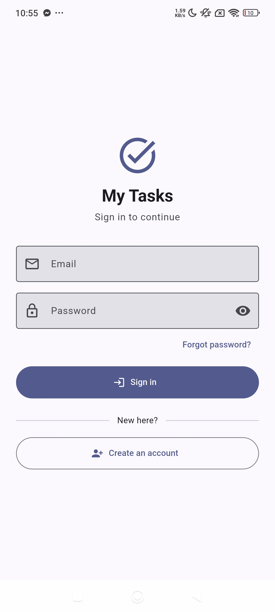 |  | 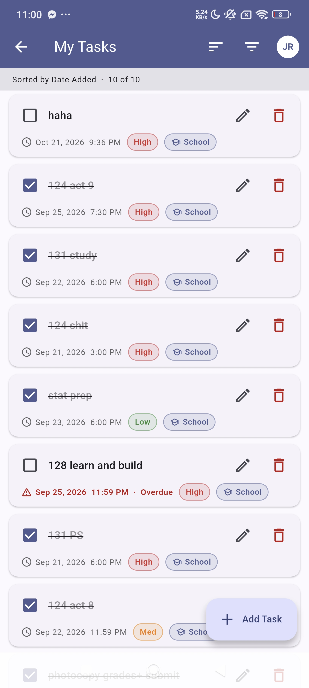 |

**Registration validation**: each rule is explained under its field before anything is sent.

| Missing password | Password too short | Passwords don't match |
|---|---|---|
| 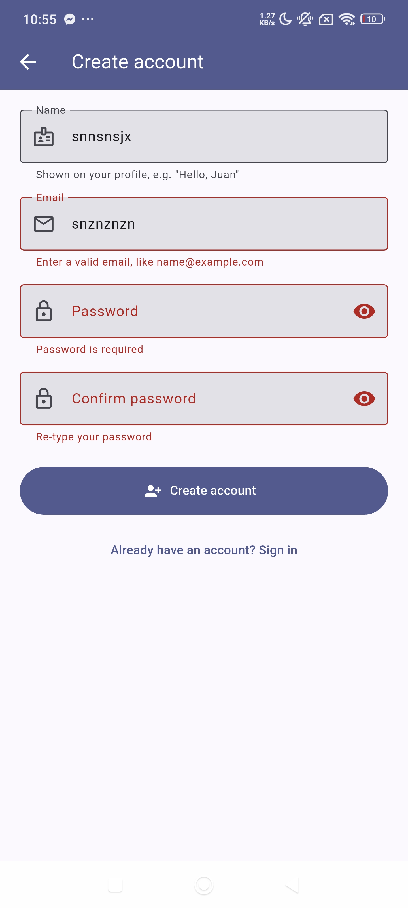 | 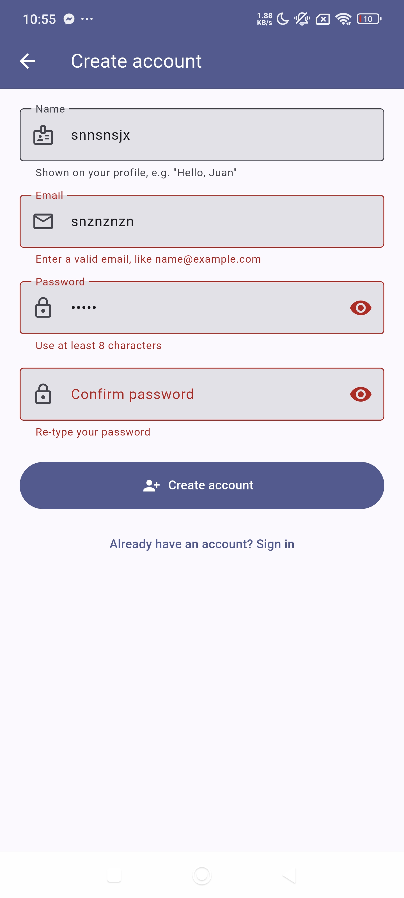 | 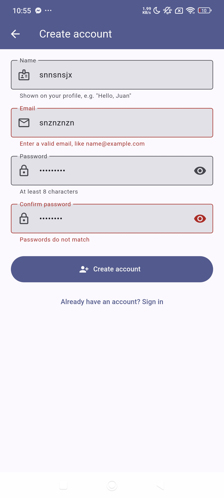 |

**Changing the email, end to end** (read left to right, then the next row).

| 1. Wrong current password | 2. Correct password: link sent | 3. Link clicked (Firebase's page) |
|---|---|---|
| 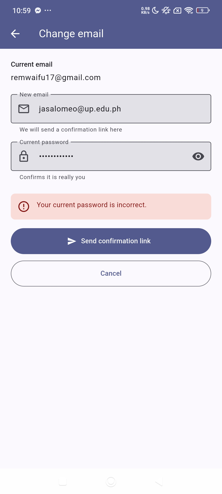 | 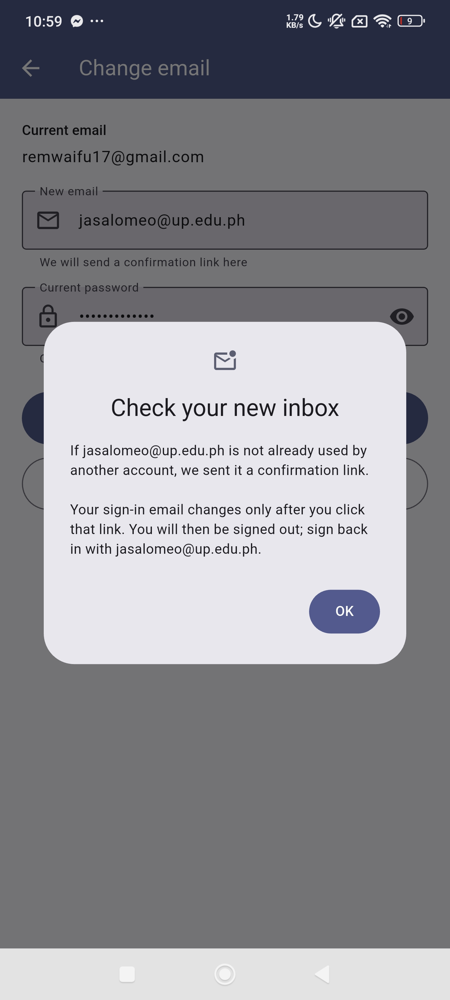 | 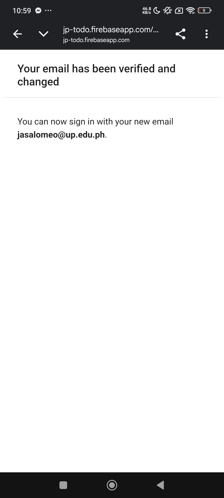 |

| 4. App signs out the old session | 5. Signed in with the new email | Password reset link sent |
|---|---|---|
| 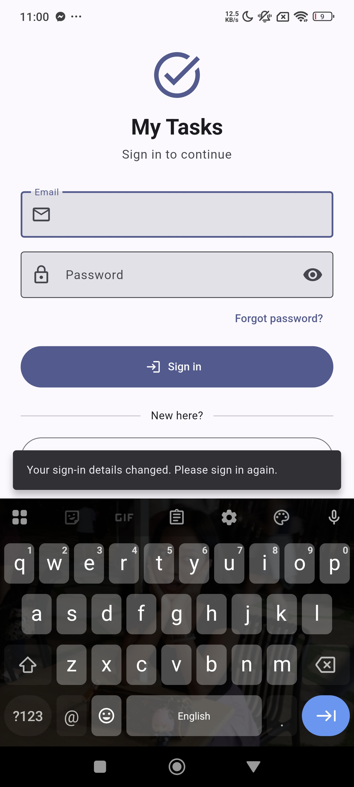 | 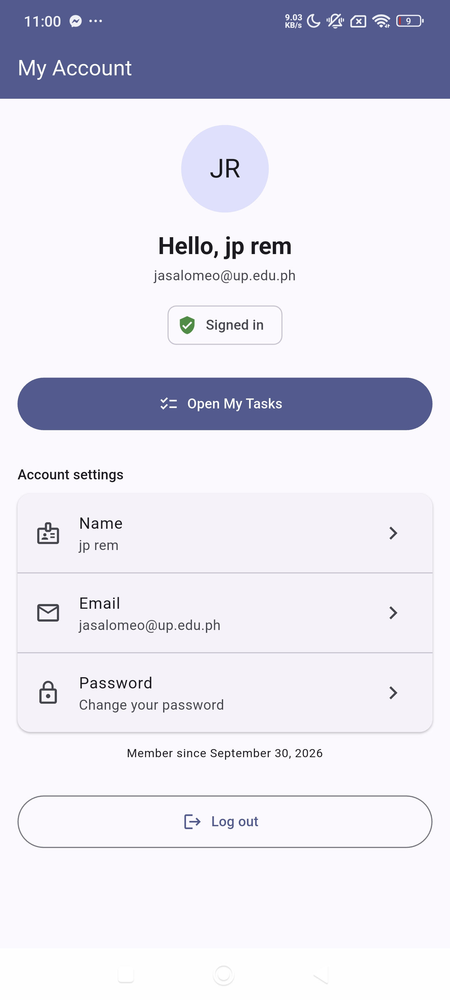 | 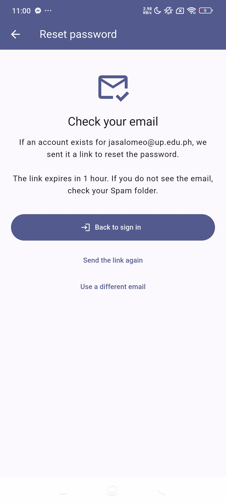 |

**Unsaved changes are never silently discarded**

| Edit name | Change email | Change password |
|---|---|---|
| 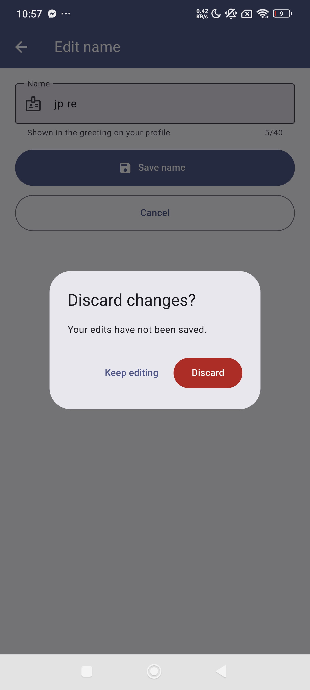 | 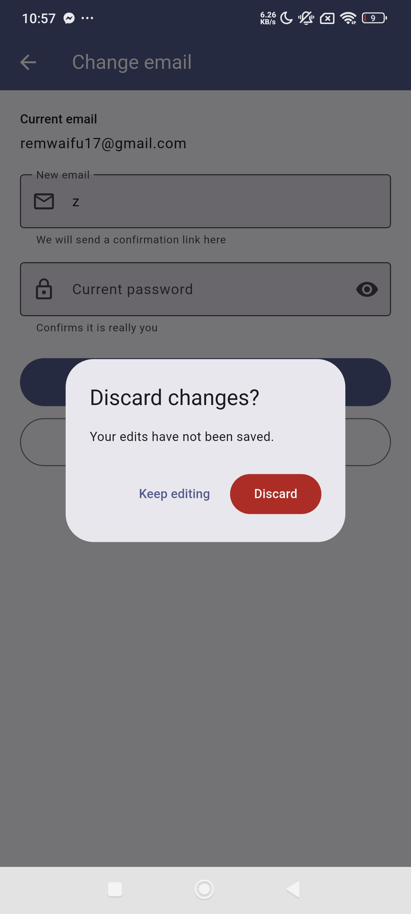 | 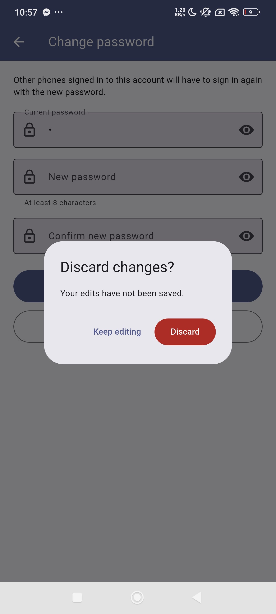 |

---

## Lab 1: task data operations

All task operations live in `lib/services/task_service.dart`.

| Operation | UI trigger | Service method | Firestore call |
|---|---|---|---|
| **Create** | "Add task" on the form | `addTask(...)` | `tasks.add({...})` |
| **Read** | Task list | `watchTasks()` | `tasks.snapshots()` |
| **Update** | "Save changes" on the form | `updateTask(task)` | `tasks.doc(id).update({...})` |
| **Update** (done) | Checkbox on a row | `setDone(id, value)` | `tasks.doc(id).update({'isDone': v})` |
| **Delete** | Delete → confirm dialog | `deleteTask(id)` | `tasks.doc(id).delete()` |
| **Restore** (undo) | "UNDO" in the snackbar | `restoreTask(task)` | `tasks.doc(id).set({...})` |

### The `tasks` collection

One document per task. The document ID is auto-generated by Firestore, which is
how two tasks with identical titles stay distinct: the ID lives in the
document's *path*, not in its body.

| Field | Type | Notes |
|---|---|---|
| `title` | string | Required, trimmed, max 100 chars |
| `dueDate` | timestamp | Date **and** time in one field |
| `priority` | string | `low` / `med` / `high` |
| `tag` | string | `school` / `personal` / `others` |
| `isDone` | boolean | Defaults to `false` |
| `createdAt` | timestamp | Set by `FieldValue.serverTimestamp()`; used by the "Date Added" sort |
| `updatedAt` | timestamp | Refreshed on every edit |
| `ownerId` | string | The owner's UID (Lab 3). Set on create, never changed. The rules check it on every request |

### Lab 1 features

- **Undo delete:** a 5-second UNDO in the snackbar. It re-creates the task with its
  original document ID and `createdAt`.
- **Filter and sort:**
  - Sort by Date Added, Due Date, Priority, or Tag.
  - Filter by Tag, Priority, or hide completed.
  - Both run in app code (`lib/logic/task_filter.dart`), because combining
    `where` + `orderBy` in Firestore needs hand-built composite indexes.

### Lab 1 screenshots

| Task list | Add task | Edit task |
|---|---|---|
|  |  |  |

| Delete confirmation | Undo snackbar | Task restored |
|---|---|---|
|  |  |  |

| Filter sheet | Sort menu | Empty state |
|---|---|---|
|  |  |  |
