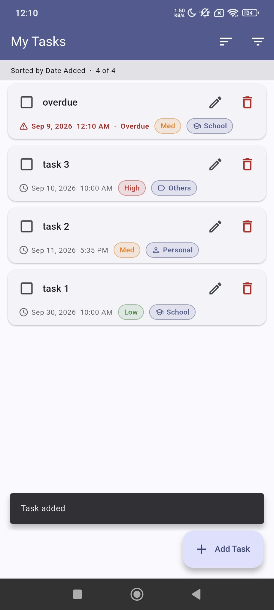
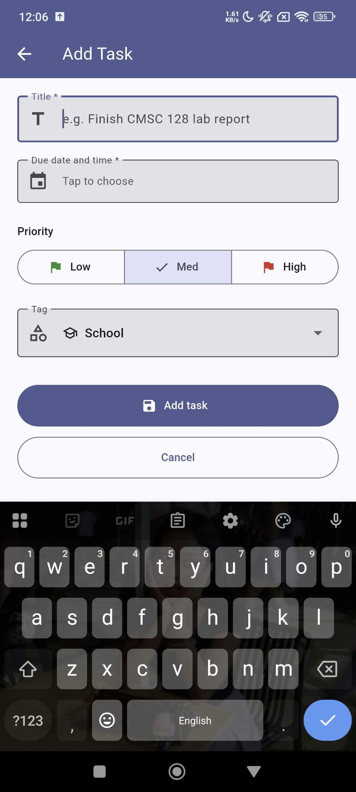
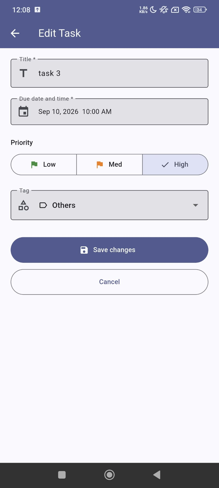
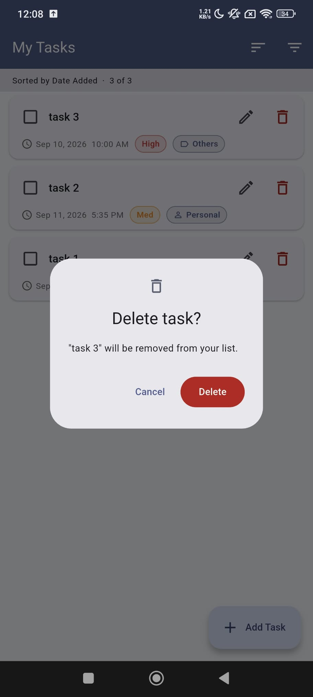
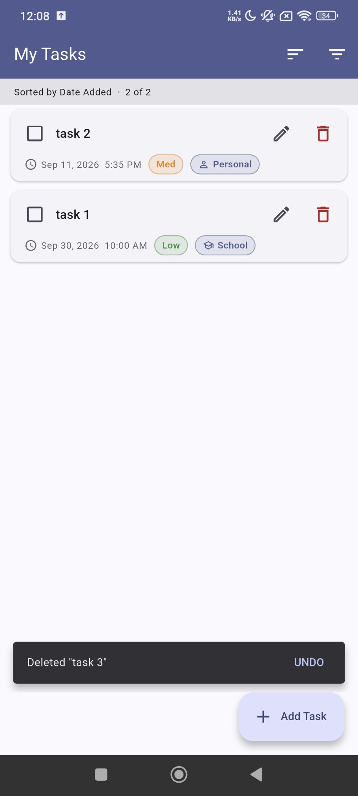
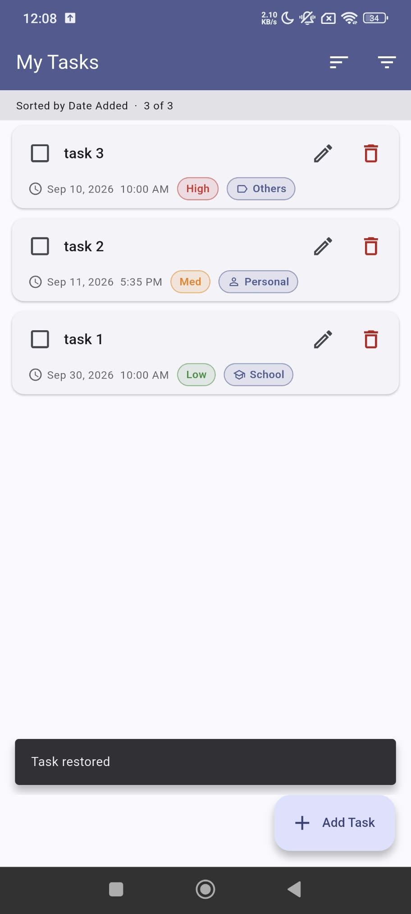
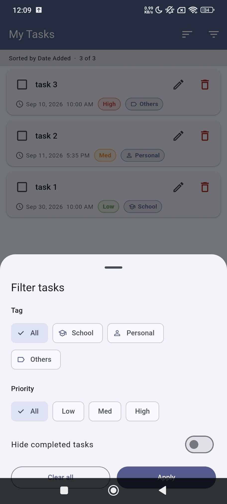
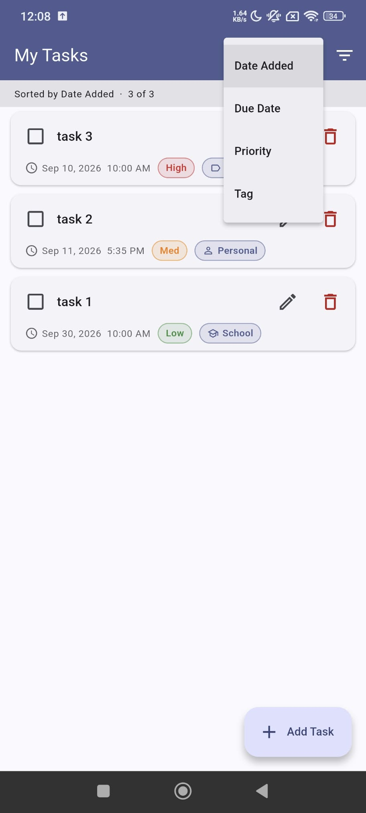
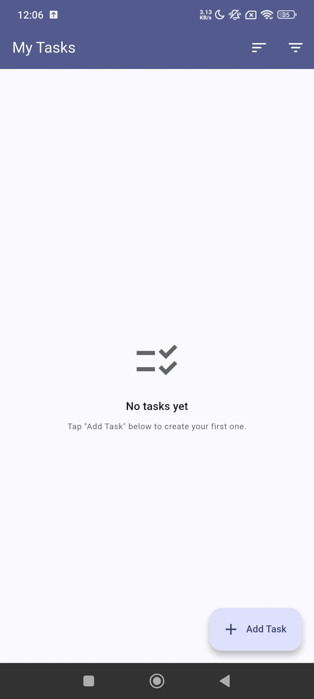

# CMSC 128 — My Tasks (Lab 1: CRUD · Lab 2: Accounts)

A to-do list Android app with user accounts. People create an account, sign in,
stay signed in across restarts, manage their profile, and recover a forgotten
password by email. Signed-in users get the full task list from Lab 1: create,
read, update, delete, undo, filter, and sort.

**Author:** JP Salomeo
**Stack:** Flutter (Dart) + Firebase Authentication + Cloud Firestore — "FlutterFire"
**Branch:** `act2-accounts` (Lab 2). `main` holds the Lab 1 submission.

---

## Tech stack, and why

| Layer | Choice | Why |
|---|---|---|
| Frontend | **Flutter 3.47** (Dart 3.13), Android | One codebase; the declarative widget model redraws from live streams (tasks, and now the signed-in user). |
| Backend | **Firebase** (managed, no server code of our own) | Google runs the servers. The app calls Firebase through its SDKs over HTTPS, and Firebase enforces the rules. |
| Authentication | **Firebase Authentication**, email + password (`firebase_auth`) | The brief asks for "the chosen framework's established feature". Firebase hashes passwords server-side with a salted, deliberately slow **scrypt**; our code never stores, hashes, or compares a password. |
| Account store | **Firebase Authentication's user store** | Holds the UID, email, display name, and password hash for every account. It is persistent and survives app restarts, reinstalls, and anything that happens to the phone. |
| Task database | **Cloud Firestore** (Standard edition) | Document store with live `snapshots()` streams and offline cache (see Lab 1 notes below). |
| Security rules | `firestore.rules` (committed) | The server-side gate: tasks require a signed-in user. |

**Why Firebase Authentication instead of our own users table?** Writing password
storage by hand is where real systems go wrong: unsalted hashes, fast hashes,
or reversible encryption. Firebase Auth already implements the OWASP
recommendations (salted adaptive hashing, rate limiting, generic sign-in errors,
one-time reset links), and it plugs straight into Firestore rules through
`request.auth`. The tradeoff: account storage is managed by Google. We can't
change the hashing algorithm or add custom columns to the account record.

**Why no separate `users` collection in Firestore?** Everything the brief
requires (unique ID, email, display name, hashed password) already lives on the
Firebase Auth account record. A second copy in Firestore would have to be kept
in sync by hand, so each fact lives in exactly one place instead.

---

## Features

### Minimum requirements

| Requirement | How it works |
|---|---|
| **Registration** | Name, email, password, and confirm password. Validation runs before sending. A duplicate email gets "An account already exists for that email." |
| **Login** | Email + password. A wrong password or unknown email gives one generic message: "Incorrect email or password." |
| **Successful login page** | Signing in lands on the **Profile page**: "Hello, *name*", the account's email, and a **Log out** button. |
| **Logout** | Deletes the session from the phone and returns to Sign in. Back cannot return to protected screens. |
| **Session persistence** | Closing and reopening the app, even after a phone restart, keeps the user signed in. |
| **Database persistence** | Accounts live in Firebase Authentication on Google's servers, not in the app's memory. |

### Expanded requirements

| Requirement | How it works |
|---|---|
| **Profile page: name** | Edit name → saved to the account → the greeting updates immediately. |
| **Profile page: email** | Requires the current password; a confirmation link is sent to the new address, and the email changes only after it is clicked. See *Email changes* below. |
| **Profile page: password** | Current password + new password (8+ chars) + confirmation. Other devices are signed out. |
| **Password recovery via email** | "Forgot password?" → Firebase emails a one-time link (valid 1 hour) → the user sets a new password on Firebase's page → the **old password stops working**. |

### Security and HCI

- **No plaintext passwords anywhere.** Not in Firestore, not in the app's storage, not in logs.
- **Server-enforced protection.** Protected screens exist only while signed in (`AuthGate`), and `firestore.rules` rejects task requests that carry no sign-in token.
- **Sensitive changes re-check the password.** Changing email or password requires the current password, even while signed in.
- **Forms.**
  - Clear labels, the email keyboard for email fields, and password managers can autofill and save.
  - Show/hide password toggles.
  - Errors appear under the field; server errors appear in a red banner next to the button.
  - Each submit button shows a spinner and blocks double taps.
  - Successes show a snackbar.
- **Unsaved changes are never silently lost.** Leaving an edited profile form asks "Discard changes?"
- **The sign-in state is always visible.** The profile shows a "Signed in" chip and the email; the task list shows the user's initials in the app bar.

---

## Project structure

```
lib/
├── main.dart                       # entry point: sets up Firebase, starts AuthGate
├── firebase_options.dart           # GENERATED, NOT COMMITTED (see Setup)
├── theme.dart                      # colours + Material theme, defined once
├── models/
│   └── task.dart                   # the Task model
├── services/
│   ├── auth_service.dart           # THE AUTH LAYER: every Firebase Auth call
│   └── task_service.dart           # THE PERSISTENCE LAYER: every Firestore call
├── logic/
│   ├── validators.dart             # pure form checks (email, password, name)
│   ├── auth_errors.dart            # Firebase error code -> plain message
│   ├── account_labels.dart         # greeting name + initials
│   └── task_filter.dart            # pure filter + sort functions
├── screens/
│   ├── auth_gate.dart              # ROUTE PROTECTION: signed out -> Login, signed in -> Profile
│   ├── login_screen.dart
│   ├── register_screen.dart
│   ├── forgot_password_screen.dart
│   ├── profile_screen.dart         # "Hello, <name>", settings, Log out
│   ├── edit_name_screen.dart
│   ├── change_email_screen.dart
│   ├── change_password_screen.dart
│   ├── home_screen.dart            # the task list (Lab 1)
│   └── task_form_screen.dart       # add / edit a task (Lab 1)
└── widgets/
    ├── password_field.dart         # password input with show/hide
    ├── submit_button.dart          # button with loading spinner
    ├── error_banner.dart           # inline error box
    ├── discard_changes_guard.dart  # "Discard changes?" on leaving an edited form
    ├── task_tile.dart
    ├── delete_confirm_dialog.dart
    └── filter_sort_sheet.dart
test/
├── validators_test.dart
└── auth_errors_test.dart
firestore.rules                     # security rules (committed on purpose)
```

The project follows two rules:
- **No screen imports `firebase_auth` to change an account.** Every sign-in, sign-up, and profile change goes through `AuthService`.
- **No screen imports `cloud_firestore`.** Every task operation goes through `TaskService`.

---

## Account data model

Each account is one record in Firebase Authentication:

| Field | Set when | Notes |
|---|---|---|
| `uid` (`localId` in exports) | Registration | Unique and permanent; generated by Firebase. Lab 3 will stamp it on each task as `ownerId`. |
| `email` | Registration / email change | Unique across the project (Firebase rejects duplicates). Used to sign in and to receive recovery links. |
| `displayName` | Registration / Edit name | Shown in "Hello, *name*". |
| `passwordHash` + `salt` | Registration / password change / reset | scrypt hash with a per-account random salt. The password itself is never stored. |
| `createdAt`, `lastSignedInAt` | Automatically | Shown as "Member since…" on the profile. |

---

## Authentication operations

There is no custom backend, so there are no custom REST endpoints. The
equivalent is the set of SDK calls below, all in `lib/services/auth_service.dart`.
Each SDK call corresponds to a request to Google's Identity Toolkit REST API.
The last column names the matching method from its public v1 REST reference,
for comparison.

| Flow | Screen | `AuthService` method | Firebase SDK call | Identity Toolkit REST equivalent |
|---|---|---|---|---|
| Register | `RegisterScreen` | `register()` | `createUserWithEmailAndPassword()` then `user.updateDisplayName()` | `accounts:signUp`, then `accounts:update` |
| Sign in | `LoginScreen` | `signIn()` | `signInWithEmailAndPassword()` | `accounts:signInWithPassword` |
| Restore session | `AuthGate` | `currentUser`, `authStateChanges()` | reads the saved session; refreshes the ID token when needed | `securetoken.googleapis.com/v1/token` |
| Log out | `ProfileScreen` | `signOut()` | `signOut()` | *(local only: deletes the saved tokens)* |
| Forgot password | `ForgotPasswordScreen` | `sendPasswordReset()` | `sendPasswordResetEmail()` | `accounts:sendOobCode` (`PASSWORD_RESET`) |
| Edit name | `EditNameScreen` | `updateDisplayName()` | `user.updateDisplayName()` | `accounts:update` |
| Change email | `ChangeEmailScreen` | `changeEmail()` | `reauthenticateWithCredential()` then `verifyBeforeUpdateEmail()` | `accounts:signInWithPassword`, then `accounts:sendOobCode` (`VERIFY_AND_CHANGE_EMAIL`) |
| Change password | `ChangePasswordScreen` | `changePassword()` | `reauthenticateWithCredential()` then `updatePassword()` | `accounts:signInWithPassword`, then `accounts:update` |
| Detect outside changes | `ProfileScreen` (open, resume, pull down) | `refreshUser()` | `user.reload()` | `accounts:lookup` |

Task operations (Lab 1) are unchanged. See *Lab 1: task data operations* below.

---

## How sessions work

1. **Signing in** sends the email and password over HTTPS to Firebase
   Authentication. Firebase hashes the attempt with the account's salt, compares it
   to the stored hash, and on a match returns two tokens:
   - an **ID token**: a signed JWT that proves who the user is. It expires after **1 hour**.
   - a **refresh token**: long-lived, used to get a new ID token when the old one expires.
2. **The Firebase SDK saves both tokens** in the app's private storage on the
   phone. That is the "real session mechanism" the app relies on, not a variable
   in memory.
3. **On every app start**, `Firebase.initializeApp()` restores the saved session,
   so `AuthGate` (`lib/screens/auth_gate.dart`) already knows the user on the
   first frame and shows the Profile page. Closing the app, restarting the phone,
   or pressing Back never signs anyone out.
4. **Every Firestore request** carries the current ID token. `firestore.rules`
   sees it as `request.auth`. Without it, the rules reject the request.
5. **Route protection.** `AuthGate` listens to `authStateChanges()`:
   - signed out → `LoginScreen`
   - signed in → `ProfileScreen`

   Whenever the signed-in user changes, it also closes every screen stacked on
   top. So after logout, Back cannot reveal the task list or a profile form.
6. **Logging out** calls `signOut()`, which deletes both saved tokens from the
   phone. `authStateChanges()` emits `null`, and `AuthGate` shows the sign-in
   screen.
   - *Limitation:* sign-out is local. An ID token copied off the phone *before*
     logout would stay valid until its hour runs out.
   - Revoking every session server-side needs the Firebase Admin SDK, which
     requires a trusted server.
7. **Sessions ended elsewhere.** Firebase revokes the refresh tokens whenever the
   password or email changes, so other devices must sign in again. The Profile
   page checks this with `refreshUser()` when it opens and whenever the app
   returns to the foreground. If the session was revoked, the app signs out and
   asks the user to sign in again.

---

## How password recovery works

1. **Request.** On Sign in → **Forgot password?**, the user enters their email.
   `AuthService.sendPasswordReset()` calls `sendPasswordResetEmail()`.
2. **Verify.** Firebase emails a link containing a **one-time code that expires
   after 1 hour**. Only someone who can read that inbox can use it. That is how
   the request is verified as coming from the account's owner.
3. **Set a new password.** The link opens a page Firebase hosts
   (`jp-todo.firebaseapp.com/__/auth/action`), where the user types a new
   password. Firebase hashes and stores it and discards the old hash.
4. **Result.** The old password is rejected from then on; the new one works.
   Existing sessions on other devices are revoked.

**Privacy detail:** the app never says whether the email has an account. It
always shows "If an account exists for that email, we sent it a link".
Firebase's *email enumeration protection* (on by default) also makes the server
answer the same way either way. Otherwise, anyone could use this screen to test
which emails are registered.

**Limitations.**
- The new password is set on Firebase's web page, not inside the app.
- Firebase's emails can land in Spam.
- Recovery depends on the user still having access to their email inbox.

### Email changes

Changing the email needs the current password. After that, Firebase emails a
confirmation link to the **new** address, and nothing changes until it is
clicked. That proves the user owns the new inbox before it can be used to sign
in or recover the account. Firebase then signs the account out everywhere, and
the user signs back in with the new email.

Because email enumeration protection is on, Firebase does not tell the app when
the new address already belongs to another account. It simply sends nothing, so
a duplicate can never be created. The app's message is worded to match: "If
*new email* is not already used by another account, we sent it a confirmation
link."

---

## Setup

### Prerequisites

- Flutter SDK 3.47+ (`flutter --version`)
- Android SDK / Android Studio
- A Firebase project with **Cloud Firestore** enabled
- Node.js + the Firebase CLI (`npm install -g firebase-tools`)
- On Windows: **Developer Mode** enabled (Flutter needs symlink support for plugins)

### 1. Get the code

```bash
git clone https://github.com/ysxiaixsy/cmsc128-Lab1_CRUD_Salomeo.git
```

```bash
cd cmsc128-Lab1_CRUD_Salomeo
```

```bash
git switch act2-accounts
```

```bash
flutter pub get
```

### 2. Connect your Firebase project

`lib/firebase_options.dart` and `android/app/google-services.json` are **not in
this repository** (see *Secrets*). Regenerate them:

```bash
dart pub global activate flutterfire_cli
```

```bash
firebase login
```

```bash
flutterfire configure --project=<your-project-id> --platforms=android
```

### 3. Turn on email/password sign-in (one time, in the Firebase console)

1. **Authentication → Get started → Sign-in method → Email/Password → Enable.**
   Leave "Email link (passwordless sign-in)" off.
2. *Recommended:* **Authentication → Settings → Password policy → Require**, with
   a minimum length of 8. This makes Firebase's hosted reset page enforce the
   same rule as the app.
3. *Recommended:* **Project settings → General → Public-facing name → "My Tasks"**,
   so reset emails show the app's name.

No database seeding or migration is needed. Accounts are created from the app,
and Firestore creates the `tasks` collection on the first write.

### 4. Deploy the security rules

`firebase.json` is generated per machine and gitignored. Make sure it contains
`"firestore": { "rules": "firestore.rules" }`, then:

```bash
firebase deploy --only firestore:rules --project <your-project-id>
```

### 5. Run or build

```bash
flutter run
```

```bash
flutter build apk --release
```

The APK is written to `build/app/outputs/flutter-apk/app-release.apk`.

### 6. Tests

```bash
flutter test
```

These unit tests cover the form validators and the error messages. They run on
the computer; no phone or emulator is needed.

---

## Inspecting accounts (DB-inspection tool)

Two tools, both reading the same Firebase Authentication user store:

**1. Firebase console → Authentication → Users** (web)

Lists every account's email, UID, and created / last sign-in dates. It never
shows passwords, not even hashed. It connects through the Google account that
owns the project.

**2. Firebase CLI `auth:export`** (terminal + any JSON viewer)

```bash
firebase auth:export C:\Users\<you>\Desktop\accounts.json --format=json --project jp-todo
```

Each account appears as one record with `localId` (the UID), `email`,
`displayName`, `passwordHash`, `salt`, `createdAt`, and `lastSignedInAt`.
`passwordHash` is a base64 scrypt hash. It is the evidence that no plaintext
password is stored, and it cannot be turned back into the password.

The CLI connects with the Google account from `firebase login`, calling
Firebase's admin API. Only project Owners/Editors can read the hash fields.

**Handling rules:**
- Export **outside the repository**. `accounts*.json` is gitignored as a safety net.
- Delete the file after use.
- Never publish the project's "password hash parameters" (console → Authentication → ⋮).
  Its signer key is what would let someone attack the hashes offline.

---

## Secrets

`lib/firebase_options.dart`, `android/app/google-services.json`, `firebase.json`,
`.firebaserc`, `.env*`, and account export files are listed in `.gitignore`.
None of them has ever been committed.

A Firebase client config is **not a password**. It is a public identifier that
ships inside every compiled app, where anyone can extract it. What actually
controls access is:
- **Firebase Authentication**, which proves who a request comes from;
- **`firestore.rules`**, which decides what that user may do.

That is why the rules file *is* committed: the security model should be
reviewable. This app has no server-side secrets of its own. There is no
service-account key or reset secret anywhere in the code.

---

## Toward Lab 3 (owner-based access control)

- Every account has a permanent `uid`, and Firestore rules can already read it as
  `request.auth.uid`.
- Lab 3 adds an `ownerId` field to each task (set to the creator's UID), filters
  the task stream to the signed-in user's tasks, and tightens `firestore.rules`
  to `request.auth.uid == resource.data.ownerId`. The exact replacement rule is
  written as a comment in `firestore.rules`.
- Until then, all signed-in users share one task list.

---

## Lab 1: task data operations

All task operations live in `lib/services/task_service.dart`.

| Operation | UI trigger | Service method | Firestore call |
|---|---|---|---|
| **Create** | "Add task" on the form | `addTask(...)` | `tasks.add({...})` |
| **Read** | Task list | `watchTasks()` | `tasks.snapshots()` |
| **Update** | "Save changes" on the form | `updateTask(task)` | `tasks.doc(id).update({...})` |
| **Update** (done) | Checkbox on a row | `setDone(id, value)` | `tasks.doc(id).update({'isDone': v})` |
| **Delete** | Delete → confirm dialog | `deleteTask(id)` | `tasks.doc(id).delete()` |
| **Restore** (undo) | "UNDO" in the snackbar | `restoreTask(task)` | `tasks.doc(id).set({...})` |

### The `tasks` collection

One document per task. The document ID is auto-generated by Firestore, which is
how two tasks with identical titles stay distinct: the ID lives in the
document's *path*, not in its body.

| Field | Type | Notes |
|---|---|---|
| `title` | string | Required, trimmed, max 100 chars |
| `dueDate` | timestamp | Date **and** time in one field |
| `priority` | string | `low` / `med` / `high` |
| `tag` | string | `school` / `personal` / `others` |
| `isDone` | boolean | Defaults to `false` |
| `createdAt` | timestamp | Set by `FieldValue.serverTimestamp()`; used by the "Date Added" sort |
| `updatedAt` | timestamp | Refreshed on every edit |

### Lab 1 features

- **Undo delete:** a 5-second UNDO in the snackbar. It re-creates the task with its
  original document ID and `createdAt`.
- **Filter and sort:**
  - Sort by Date Added, Due Date, Priority, or Tag.
  - Filter by Tag, Priority, or hide completed.
  - Both run in app code (`lib/logic/task_filter.dart`), because combining
    `where` + `orderBy` in Firestore needs hand-built composite indexes.

### Lab 1 screenshots

| Task list | Add task | Edit task |
|---|---|---|
|  |  |  |

| Delete confirmation | Undo snackbar | Task restored |
|---|---|---|
|  |  |  |

| Filter sheet | Sort menu | Empty state |
|---|---|---|
|  |  |  |
